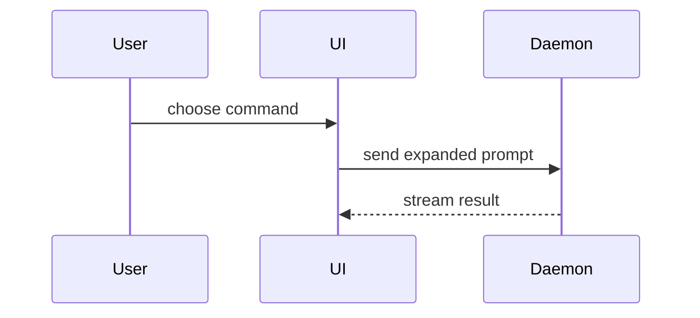

# Write a PR as a decision record

The PR body is the **decision interface** between implementation and review. A maintainer with no prior context should quickly understand *why this matters, what changed, why this approach, what was verified, and what remains unsafe or undecided*. Link deeper sources instead of reproducing them. Optimize for decision complexity and risk, not diff size or a section quota.

## Process

1. **Ground.** Inspect the diff against the intended base, affected behavior, linked issue/PRD/ADR, `CONTRIBUTING.md`, testing rules, and `GLOSSARY.md` if present. Inspect actual test outputs and CI status when accessible. **Complete when:** you can distinguish documented intent, observed behavior, and unknowns for every material change.
2. **Assess.** Identify important design tradeoffs, documentation or product decisions, verification gaps, and **merge danger**: one-way vs two-way door (reversibility) and blast radius (who/what can break). **Complete when:** every merge-relevant concern has a clear place in the body or a linked authoritative source.
3. **Write.** Use **Summary → Evidence → Merge Danger** as the only possible top-level headings; omit any heading that adds no decision value. Embed a Changes table and references within Summary when useful; put risks, blockers, and reviewer guidance within Merge Danger. Retain the original skill's before/after evidence and visual explanations when they clarify the change. **Complete when:** a reviewer can find intent, proof, and risk without reconstructing the work.
4. **Audit.** Match each claim to the diff, requirement, observed result, or a link; distinguish pass/fail/skip/not run/unknown and current vs stale CI. Remove repeated assertions, empty headings, and code narration. **Complete when:** a reviewer can tell what is established, what is proposed, and what blocks merge.

## Adaptive PR body

```markdown
## Summary
<Why now, intended goal, behavior/outcome, project or user impact: 1–3 sentences.>
<Optional: smallest useful diagram, diff-sketch, tree, or pseudocode.>

<!-- Optional when multiple logical changes benefit from a scannable map. -->
| Changes | Effect |
| --- | --- |
| <Logical chunk> | <Behavior, capability, or reviewer-relevant impact> |

**References:** <Optional: issue, PRD, ADR, related work, documentation impact or proposed doc changes. Place at the end of Summary; omit if no useful links or decisions.>

## Evidence
- **Before:** <Observed baseline / failing test / screenshot, when meaningful>
- **After:** <Observed result / passing test / screenshot, with reference>
- **Checks:** <Actual runs, outcomes and evidence links>
- **Gaps:** <Relevant tests or environments not verified, and why>

## Merge Danger
**Door:** <one-way | two-way; why if not obvious>
**Blast Radius:** <scope and likely impact>

**Risks & Blockers:** <Optional: compatibility, migration, rollout, rollback, limitations or unresolved decisions; distinguish merge blockers from follow-ups.>

**Review Guide:** <Optional: targeted manual verification or hard-to-spot review focus.>
```

## Why each part earns space

- **Summary** frames the decision in product/project context, including the problem or acceptance criterion. When the work has distinct logical chunks, a short **Changes** table maps each to its effect without creating another section or narrating the diff. Explain non-obvious tradeoffs only where they change the reviewer's decision. Put optional **References** at the end of Summary to preserve traceability: link to issues, PRDs, ADRs, and related work rather than duplicating them. Durable README/docs describe the current system; proposed PRD/README changes need approval under repository policy.
- **Evidence** supports confidence with observations rather than claims. Favor before/after screenshots for UI and execution-based tests, outputs, or metrics elsewhere. Give exact outcomes and relevant coverage gaps. Current CI and branch protection remain authoritative; a self-checked contribution box is not proof.
- **Merge Danger** determines review and deployment caution. A *two-way door* is cheap to roll back; a *one-way door* has irreversible consequences. Blast radius includes users, data, API consumers, operations, and UX—not only touched files. Add **Risks & Blockers** for meaningful unknowns or release concerns, distinguishing blockers from follow-ups. Add a **Review Guide** only for targeted manual checks or unusual diff boundaries that would otherwise be missed. An author cannot grant approval by writing a green status.

## Presentation and size

Use repository domain terminology (`GLOSSARY.md` where available). For nontrivial structure or behavior, consult **Visual patterns** below.

For an obvious fix, one short paragraph and a verification result may suffice; omit the Changes table, optional labels, and unremarkable risk commentary. For ordinary work, aim around 150–350 words; complex changes may warrant 300–600 plus linked design documents. These are heuristics, not targets. Keep the actual body succinct even when upstream research and verification were extensive.

## Visual patterns

### Summary

Pick the smallest view that makes the key point clear.

- Show logic or an algorithm as pseudocode:

```text
on(save)
  if content is unchanged
    return cached result
  write new content
  return fresh result
```

- Show runtime control flow as a call tree:

```text
submitForm
  createSession
    persistPrompt
    launchAgent
  navigateToSession
```

- Show UI structure as a component tree, including state and module boundaries that matter:

```text
<SessionPage> (apps/example/src/routes/session.tsx)
  useSessionEvents()
  <SessionToolbar>
    <RunSkillButton> (packages/ui)
```

- Show file responsibility or a broad refactor as a shallow file tree:

```text
src/
├── commands/       # parses user actions
├── sessions/       # owns session state
└── transport/      # sends API requests
```

- Show component interaction, control flow, or data flow with Mermaid:



- Use `diff` when the point is what changes and the surrounding shape already exists. Match the diff shape to the topic.

For a component change:

```diff
 <SessionPage>
   useSessionEvents()
   <SessionToolbar>
+    <RunSkillButton />
   <SessionTimeline>
+    <SkillResultCard />
```

For a file-layout change:

```diff
 src/
 ├── commands/
+│   └── show-me.ts       # expands the slash command
 ├── sessions/
-└── transport.ts
+└── transport/
+    ├── client.ts
+    └── stream.ts
```

For a call-tree or call-stack change:

```diff
 submitForm
   createSession
     persistPrompt
+    expandSkillMention
     launchAgent
-  navigateToSession
+  navigateToSession
+    subscribeToEvents
```

For a state or control-flow change:

```diff
 on(save)
-  write content
+  if content is unchanged
+    return cached result
+  write new content
+  invalidate cache
```

- Show the whole block when most of it is new, when omitted context would hide ownership or order, or when the user needs a copyable target shape:

```ts
function expandSkill(command: string): string {
  const skillName = command.slice(1);
  return `use the ${skillName} skill`;
}
```

#### Guidance

Place each visual next to the short text it supports. Keep only the calls, files, props, states, and boundaries needed to answer the user's current question or the options to resolve the current discussion point.

You may use one of these, you may use several, it is unlikely you will use all of them. Use your judgement and don't overwhelm the user.
